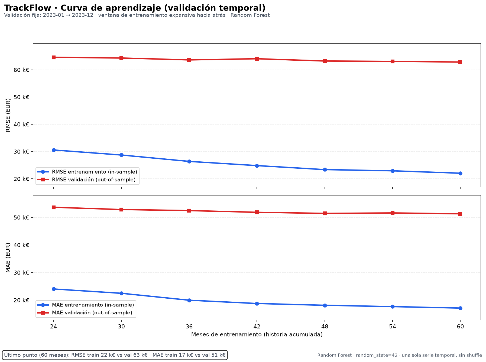

# Evaluación temporal del modelo de pronóstico de ingresos — TrackFlow

**Modelo:** `RandomForestRegressor` sobre el crecimiento interanual logarítmico
(`yoy_log_growth`) y reconstrucción multiplicativa del ingreso en EUR.
**Variable objetivo de negocio:** `revenue_eur` de la fila `market = "consolidated"`.
**Dataset:** `data/raw/trackflow_sales.csv`, 120 meses, `2016-01` → `2025-12`.
**Referencia de negocio:** `CONTEXT.md` (briefing de empresa) y
`docs/models-training-rag/evaluating-regression-model.md`.

---

## 0. Resumen ejecutivo

| Elemento | Resultado |
|---|---|
| Protocolo | `TimeSeriesSplit`, 6 folds × 8 meses, `shuffle=False`, `gap=0` |
| Set evaluado | Train 2018-01 → 2023-12 (72 filas efectivas) |
| Test 2024-2025 | **No usado** en esta evaluación |
| MAE validación | **37.716 ± 9.839 EUR** |
| RMSE validación | **46.224 ± 10.293 EUR** |
| MAPE validación | **3,49 ± 0,62 %** |
| Diagnóstico | **Overfitting (sobreajuste por varianza)** |
| Acción propuesta | Subir `min_samples_leaf` de 3 a 5 |

La brecha entre error de entrenamiento y validación es grande y persistente:
el MAPE de train es **1,68 ± 0,06 %** frente a **3,49 ± 0,62 %** en validación.
La curva de aprendizaje confirma que añadir más historia apenas mejora la
validación (RMSE 64.561 → 62.815 EUR al pasar de 24 a 60 meses), mientras el
error de train sigue bajando. No es un problema de underfitting ni de falta de
datos: es un modelo que memoriza ruido mensual con 72 filas efectivas.

---

## 1. Contexto de negocio y métrica principal

Thomas (CEO) necesita saber si es viable anticipar el volumen de facturación
antes de invertir en un dashboard ejecutivo global. Ana (Operaciones de
Almacén) y Carlos (Última Milla y Transportistas) ya anticipan a mano los picos
de Black Friday y Navidad. El briefing describe dos patrones que el modelo debe
respetar:

- **Crecimiento:** ~6 % anual con variación de ±3 %, alternando años fuertes y
  suaves, siempre positivo.
- **Estacionalidad:** noviembre–diciembre +25–35 % sobre la media; febrero
  −10–15 %; resto de meses ±5 %.

### MAE frente a RMSE: cuál refleja mejor el coste de negocio

| Métrica | Qué mide | Lectura de negocio |
|---|---|---|
| **MAE** | Error absoluto medio en EUR | “Desviación típica de un mes cualquiera”. Fácil de comunicar a Thomas y Ana. |
| **RMSE** | Raíz del error cuadrático medio, en EUR | Penaliza de forma cuadrática los errores grandes, que son los que rompen la planificación de capacidad. |

**Métrica principal: RMSE.** TrackFlow factura por volumen de envíos gestionados
y su capacidad (≈70 operarios entre Los Ángeles y Zaragoza, 8 transportistas)
se compromete con antelación. Un error de 100.000 EUR en diciembre —cuando el
ingreso está un 25–35 % por encima de la media por Black Friday y Navidad— es
mucho más caro que diez errores de 10.000 EUR repartidos por meses normales:
obliga a horas extra, capacidad extraordinaria de transportistas y puede
comprometer SLAs con las marcas. El coste es convexo, y RMSE lo refleja; MAE lo
diluye. Además, el MSE es el KPI que pide explícitamente la spec, y RMSE es su
raíz cuadrada en EUR, directamente interpretable.

MAE se reporta como métrica secundaria y complementaria: responde a “¿cuánto
suele fallar un mes normal?”, mientras RMSE responde a “¿cuánto me puede doler
un mal mes en temporada alta?”.

---

## 2. Datos, split y filas efectivas

| Conjunto | Meses | Filas | Periodo |
|---|---:|---:|---|
| Entrenamiento | 8 × 12 | 96 | 2016-01 → 2023-12 |
| Test | 2 × 12 | 24 | 2024-01 → 2025-12 |

El modelo aprende `yoy_log_growth(t) = log(revenue_eur(t)) − log(revenue_eur(t−12))`.
Para construir el target y sus lags se necesitan los primeros 24 meses, que se
usan como **historia**, no como ejemplos de entrenamiento. Por eso la CV se hace
sobre **72 filas efectivas**, de `2018-01` a `2023-12`. El ingreso medio de esas
72 filas es **1.027.349 EUR/mes**.

El CSV conserva las columnas exactas `month`, `revenue_eur`,
`shipments_processed`, `avg_revenue_per_shipment_eur` y `market`; se filtra
`market = "consolidated"`. El dataset solo contiene esa fila: no hay filas
separadas de `us` y `spain`. La referencia 60/40 entre Los Ángeles y Zaragoza
del briefing no se puede usar como feature adicional con los datos provistos.

---

## 3. Validación cruzada temporal

### 3.1 Geometría

- Estrategia: `sklearn.model_selection.TimeSeriesSplit`.
- **6 folds × 8 meses**, `gap=0`, `shuffle=False`.
- Cada fold entrena con un prefijo expansivo y valida con el bloque inmediato
  posterior. Los tamaños de entrenamiento son 24, 32, 40, 48, 56 y 64 meses.
- Se eligió 6 × 8 en lugar de 5 × 12 porque con 5 × 12 el primer fold tendría
  solo 12 filas de entrenamiento (un año). Con 6 × 8 todos los folds tienen al
  menos 24 filas (dos años) y se siguen cumpliendo los ≥ 5 folds.
- El test 2024-2025 no se toca: la CV se ejecuta solo sobre el set de
  entrenamiento.

### 3.2 Resultados por fold

| Fold | Train | Validación | MAE train | RMSE train | MAPE train | MAE val | RMSE val | MAPE val |
|---:|---|---|---:|---:|---:|---:|---:|---:|
| 1 | 2018-01 → 2019-12 | 2020-01 → 2020-08 | 15.612 | 21.158 | 1,67 % | 27.743 | 37.435 | 3,08 % |
| 2 | 2018-01 → 2020-08 | 2020-09 → 2021-04 | 15.466 | 20.840 | 1,65 % | 31.886 | 41.203 | 3,03 % |
| 3 | 2018-01 → 2021-04 | 2021-05 → 2021-12 | 15.900 | 20.503 | 1,67 % | 31.416 | 41.616 | 3,00 % |
| 4 | 2018-01 → 2021-12 | 2022-01 → 2022-08 | 15.627 | 21.070 | 1,61 % | 39.483 | 43.311 | 3,76 % |
| 5 | 2018-01 → 2022-08 | 2022-09 → 2023-04 | 17.013 | 21.583 | 1,73 % | 40.775 | 47.672 | 3,51 % |
| 6 | 2018-01 → 2023-04 | 2023-05 → 2023-12 | 17.872 | 22.499 | 1,77 % | 54.990 | 66.110 | 4,59 % |

El fold 6 (2023) es el más exigente: su MAPE de validación es 4,59 %, muy por
encima de los folds 1–3 (~3,0 %). Por eso el resumen medio no debe leerse como
“el modelo falla exactamente 3,49 % todos los años”, sino como una estimación
con dispersión real entre regímenes.

### 3.3 Resumen media ± desviación estándar

Desviación estándar calculada entre folds con `ddof=1`.

| Conjunto | MAE (EUR) | RMSE (EUR) | MAPE (%) | MSE (EUR²) |
|---|---:|---:|---:|---:|
| Entrenamiento | 16.248 ± 974 | 21.275 ± 698 | 1,68 ± 0,06 | 453.048.710 ± 30.069.904 |
| Validación | **37.716 ± 9.839** | **46.224 ± 10.293** | **3,49 ± 0,62** | 2.224.987.767 ± 1.088.754.119 |

Lectura relativa al ingreso medio mensual (1.027.349 EUR):

- RMSE de validación: **4,50 %** del ingreso medio.
- MAE de validación: **3,67 %** del ingreso medio.
- MSE de validación: **0,211 %** de la media de ingresos al cuadrado.
- RMSE de entrenamiento: **2,07 %** del ingreso medio.

---

## 4. Control de fuga de información

La CV cumple tres condiciones explícitas:

1. **Sin shuffle.** Cada fold tiene índices estrictamente crecientes,
   `max(train_idx) < min(validation_idx)`, sin solape y con bloques de validación
   consecutivos. La concatenación de todos los índices de validación es
   estrictamente creciente: ningún índice de un fold posterior aparece antes que
   uno de un fold anterior.
2. **Features causales en las fronteras.** Para cada fold se reconstruyen las
   features truncando la serie en `validation_end` y en `train_end` y se
   comprueban contra la serie completa. Si un lag o una media rodante mirase al
   fold siguiente, la comparación fallaría.
3. **Fila de validación construida solo con el pasado.** Para cada uno de los
   8 meses de validación de cada fold se reconstruye su fila de features usando
   únicamente datos hasta `t−1`; el resultado debe ser idéntico a la fila de la
   serie completa. Esto demuestra que ninguna feature usa el mes actual ni el
   futuro.

La base de ingresos es `revenue_eur(t−12)`, un dato real conocido en el momento
de predecir, y la evaluación es **one-step**: los lags usan valores reales hasta
`t−1` y no se realimentan predicciones. Es el mismo protocolo que el holdout
2024-2025 del pipeline original, trasladado al set de entrenamiento.

La verificación está implementada en `scripts/sales_forecast/validation.py` y
cubierta por `tests/pipelines/test_sales_forecast_cv.py`.

---

## 5. Curva de aprendizaje



- Validación fija: **2023-01 → 2023-12** (último año del train).
- Entrenamiento: los `N` meses inmediatamente anteriores a 2023, con
  `N = [24, 30, 36, 42, 48, 54, 60]`.
- Cada punto respeta el orden temporal: el train termina en 2022-12 y la
  validación empieza en 2023-01.

| N meses | Train MAPE | Val MAPE | Train RMSE | Val RMSE | Brecha MAPE |
|---:|---:|---:|---:|---:|---:|
| 24 | 2,24 % | 4,54 % | 30.558 | 64.561 | 2,29 pp |
| 30 | 2,11 % | 4,42 % | 28.711 | 64.297 | 2,31 pp |
| 36 | 1,93 % | 4,37 % | 26.366 | 63.604 | 2,44 pp |
| 42 | 1,81 % | 4,37 % | 24.828 | 64.028 | 2,55 pp |
| 48 | 1,77 % | 4,34 % | 23.353 | 63.203 | 2,58 pp |
| 54 | 1,75 % | 4,35 % | 22.912 | 63.063 | 2,60 pp |
| 60 | 1,71 % | 4,32 % | 22.032 | 62.815 | 2,61 pp |

**Lectura:** al multiplicar por 2,5 la historia de entrenamiento (24 → 60 meses),
el RMSE de validación solo mejora un **2,7 %** (64.561 → 62.815 EUR) y el MAPE
0,22 puntos. En cambio, el error de train cae un **27,9 %** en RMSE (30.558 →
22.032 EUR). La curva de validación está prácticamente plana y la brecha incluso
se ensancha ligeramente. Añadir más historia no está resolviendo el problema.

---

## 6. Diagnóstico

### Clasificación: **overfitting (sobreajuste por varianza)**

Evidencia:

1. **Brecha train/validación grande y sistemática.** MAPE 1,68 % en train frente
   a 3,49 % en validación (ratio 2,08×); RMSE 21.275 frente a 46.224 EUR
   (ratio 2,17×). En los 6 folds la validación siempre es peor que el train.
2. **La brecha no se cierra al añadir datos.** En la curva de aprendizaje el
   error de validación se queda en 4,3–4,5 %, mientras el de train baja de
   2,24 % a 1,71 %. Si fuera underfitting, ambos errores serían altos y
   convergerían al crecer el set.
3. **El modelo memoriza ruido mensual.** Con 72 filas efectivas y
   `min_samples_leaf=3`, el bosque puede crear hojas de tres observaciones y
   ajustar fluctuaciones idiosincráticas del mes. El error de train de 1,68 %
   está muy por debajo del ruido mensual que describe el briefing (±5 % de
   fluctuación moderada alrededor de la tendencia en los meses normales).
4. **La complejidad no se traduce en una mejora robusta.** Frente a una
   referencia ingenua de crecimiento medio de 3 meses, el modelo mejora el RMSE
   un ~21 % (46.224 vs 58.211 EUR) y el MAE un ~20 % (37.716 vs 47.256 EUR),
   pero la diferencia es menor de lo que sugiere su capacidad. Una parte del
   ajuste del bosque es ruido, no señal.

### Por qué no es underfitting

- El error de entrenamiento es bajo (MAPE 1,68 %, RMSE 21.275 EUR), no alto.
- El modelo bate claramente a la referencia de crecimiento cero
  (RMSE 46.224 vs 77.253 EUR) y a la de lag 12 (97.983 EUR). El modelo ha
  aprendido la estacionalidad y la tendencia; no le falta capacidad para
  representar el patrón.

### Por qué no está bien ajustado

- La brecha de 1,81 pp de MAPE (2,17× en RMSE) es mucho mayor que la variación
  entre folds del train (0,06 pp) y persiste en todos los folds.
- La validación no converge hacia el train al añadir historia; la curva de
  aprendizaje muestra un plateau claro.

**Matiz importante:** el holdout 2024-2025 del pipeline original obtiene
RMSE 42.491 EUR y MAPE 2,88 %, mejores que la media de la CV. No contradice el
diagnóstico: el modelo final se entrena con las 72 filas completas (más datos
que cualquier fold), y 2024-2025 resultó ser un periodo comparativamente más
fácil. La CV es una estimación más conservadora y honesta de la varianza entre
regímenes; el holdout único de 24 meses no debe usarse para declarar “bien
ajustado” un modelo que muestra esta brecha.

---

## 7. Acción correctiva

### Causa raíz

El sobreajuste viene de la **varianza del bosque con muy pocas filas
efectivas**: `min_samples_leaf=3` permite hojas que memorizan tres meses
concretos y ruido de corto plazo. No es falta de datos (la curva de aprendizaje
está plana) ni falta de complejidad (el train ya está muy por debajo del
validation).

### Acción concreta

**Subir `min_samples_leaf` de 3 a 5**, manteniendo `max_features=0.7`,
`n_estimators=500`, `random_state=42`, las mismas features y el mismo protocolo
de CV. Es un cambio de un solo hiperparámetro, dirigido exactamente a la causa:
reduce la profundidad efectiva de las hojas y la capacidad de memorizar ruido.

Resultado del A/B sobre los mismos 6 folds:

| Configuración | Train MAPE | Val MAPE | Val MAE | Val RMSE | Brecha MAPE |
|---|---:|---:|---:|---:|---:|
| Baseline, `min_samples_leaf=3` | 1,68 ± 0,06 | 3,49 ± 0,62 | 37.716 ± 9.839 | 46.224 ± 10.293 | 1,81 pp |
| Propuesta, `min_samples_leaf=5` | 2,29 ± 0,16 | 3,54 ± 0,57 | 38.242 ± 8.963 | **46.289 ± 8.460** | **1,25 pp** |

Interpretación:

- El RMSE medio de validación queda prácticamente igual (**+0,1 %**).
- La desviación entre folds del RMSE baja un **17,8 %** (10.293 → 8.460 EUR):
  el modelo es más estable entre años.
- La brecha train/validación baja de 1,81 a 1,25 pp: el train deja de memorizar
  tanto y se acerca al comportamiento out-of-sample.
- El MAPE medio sube solo 0,05 pp (3,49 → 3,54 %).

Este es el trade-off correcto para el diagnóstico: si el objetivo fuera
solamente bajar el error medio, el baseline ya está cerca de su límite; si el
objetivo es reducir la varianza y la dependencia del año concreto, `leaf=5` es
la corrección coherente. Si Thomas prioriza aún más la estabilidad, el siguiente
paso sería `leaf=8`, que reduce más la dispersión a cambio de un pequeño
incremento del RMSE medio; no se adopta por defecto para no sacrificar el error
típico sin evidencia del holdout.

### Lo que **no** se propone

- **No “añadir más datos”**: la curva de aprendizaje muestra que pasar de 24 a
  60 meses solo mejora el RMSE de validación un 2,7 %; el problema no es el
  volumen de historia, es la varianza del modelo.
- **No “aumentar la complejidad”**: el error de train ya es 2,17× menor que el
  de validación; más capacidad ampliaría la brecha.
- **No tocar el test 2024-2025 para elegir hiperparámetros**: el A/B se hace
  solo con CV sobre el train. El holdout se reserva para la validación final de
  la configuración elegida.

### Plan de validación de la corrección

1. Reentrenar con `min_samples_leaf=5` y regenerar CV + curva de aprendizaje.
2. Aceptar el cambio solo si el RMSE de validación no empeora más de un 2 % y la
   desviación entre folds baja; en este A/B se cumple (+0,1 %, −17,8 %).
3. Evaluar una única vez la configuración elegida en el holdout 2024-2025 y
   comparar con `metrics.json` del pipeline actual.
4. Monitorizar el PSI del crecimiento y el Gini en producción; si el PSI de
   `yoy_growth` supera 0,25, revisar el modelo antes de atribuir el error a la
   corrección.

---

## 8. Comparación con las referencias

Mismas 6 folds, mismas filas de validación:

| Referencia | MAE val | RMSE val | MAPE val |
|---|---:|---:|---:|
| Crecimiento cero (`revenue(t−12)`) | 68.095 ± 33.956 | 77.253 ± 33.376 | 6,12 ± 2,58 % |
| Último crecimiento interanual (`lag 12`) | 83.900 ± 21.017 | 97.983 ± 21.749 | 7,84 ± 2,03 % |
| Crecimiento medio de 3 meses | 47.256 ± 9.229 | 58.211 ± 11.789 | 4,39 ± 0,92 % |
| **Random Forest (baseline)** | **37.716 ± 9.839** | **46.224 ± 10.293** | **3,49 ± 0,62 %** |

El modelo aporta valor frente a las referencias ingenuas, pero la referencia de
media móvil de 3 meses se acerca bastante. Eso refuerza la lectura de que parte
del ajuste del bosque es ruido y de que la regularización es la palanca
correcta antes que añadir complejidad.

---

## 9. Reproducibilidad

```bash
# Evaluación completa (genera cv_results.json, cv_folds.csv,
# learning_curve.csv y learning_curve.png)
python -m scripts.evaluate_sales_forecast

# Tests de la CV temporal y de la causalidad de features
python -m pytest tests/pipelines/test_sales_forecast_cv.py -q
```

- Semilla única: `SEED = 42`, propagada al bosque.
- `n_jobs=1` para que el entrenamiento sea reproducible bit a bit.
- Artefactos:
  - `data/eval/cv_results.json` — folds, resumen media ± std, curva, A/B y
    referencias ingenuas.
  - `data/eval/cv_folds.csv` — métricas por fold.
  - `data/eval/learning_curve.csv` — puntos de la curva.
  - `data/eval/learning_curve.png` — figura train/validación.
- Código: `scripts/sales_forecast/validation.py`,
  `scripts/evaluate_sales_forecast.py`.
- Test: `tests/pipelines/test_sales_forecast_cv.py`.

---

## 10. Limitaciones

- **72 filas efectivas** es muy poco para estimar con precisión la varianza
  entre años; la desviación estándar entre folds es informativa, no un intervalo
  de confianza formal.
- Los folds de 8 meses no cubren un año natural completo; la CV compensa con 6
  bloques consecutivos, pero la estacionalidad se reparte entre folds.
- La curva de aprendizaje usa una única validación fija (2023), el año más
  exigente; por eso sus errores son algo mayores que la media de la CV.
- El dataset solo trae `consolidated`; no se puede evaluar el PSI por mercado
  (`us`/`spain`) ni usar la proporción 60/40 de Los Ángeles/Zaragoza como
  feature.
- El modelo asume que la estacionalidad y el crecimiento de 2016–2023 siguen
  vigentes. Un cambio estructural (nueva nave, pérdida de un cliente grande,
  crisis logística) exige reentrenar y revisar el PSI del crecimiento.
- La banda de variabilidad del pipeline original es dispersión entre árboles,
  no un intervalo de confianza calibrado; este informe no la recalibra.
