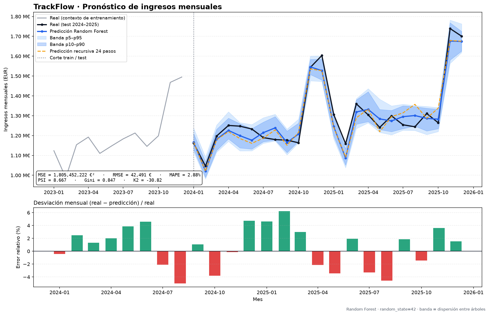

# Pronóstico de ingresos de TrackFlow — modelo de regresión

Implementación del entregable descrito en
[`sales-forecasting-regression.md`](./sales-forecasting-regression.md):
predecir el ingreso mensual consolidado de TrackFlow con un modelo de regresión
entrenado sobre `data/raw/trackflow_sales.csv`.

| Elemento | Valor |
|---|---|
| Algoritmo | **Random Forest** (`RandomForestRegressor`, scikit-learn) |
| Semilla | `random_state = 42` |
| Serie | 120 meses, `2016-01` → `2025-12`, mercado `consolidated` |
| Entrenamiento | 96 meses (`2016-01` → `2023-12`), 72 filas efectivas |
| Test | 24 meses (`2024-01` → `2025-12`), nunca vistos en entrenamiento |
| Target del negocio | `revenue_eur` |
| Target que aprende el bosque | crecimiento interanual logarítmico |

- Script: [`scripts/train_sales_forecast.py`](../../scripts/train_sales_forecast.py)
- Paquete: [`scripts/sales_forecast/`](../../scripts/sales_forecast/)
- Tests: [`tests/pipelines/test_sales_forecast_split.py`](../../tests/pipelines/test_sales_forecast_split.py)

---

## 1. Contexto de negocio

Thomas (CEO) quiere saber si es viable anticipar la facturación antes de
invertir en el dashboard ejecutivo global. Ana (Operaciones de Almacén) y Carlos
(Transportistas) ya anticipan a mano los picos de Black Friday y Navidad. El
modelo debe capturar dos patrones documentados en el briefing:

- **Crecimiento:** ~6% anual con variación de ±3%, alternando años fuertes y
  suaves (siempre positivo).
- **Estacionalidad:** noviembre y diciembre +25–35% sobre la media, febrero
  −10–15%, resto ±5%.

---

## 2. Datos y limpieza

El CSV tiene exactamente las columnas del contrato: `month`, `revenue_eur`,
`shipments_processed`, `avg_revenue_per_shipment_eur` y `market`. La validación
y limpieza viven en `scripts/sales_forecast/data.py`:

- Se filtra la fila `market == "consolidated"` (la única presente).
- Se exige el esquema exacto y se parsea `month` como fecha.
- Se eliminan duplicados por mes y se reindexa el rango mensual completo.
- Los nulos se interpolan linealmente en el tiempo y se arrastran en los
  extremos; si quedara alguno, el pipeline falla en lugar de entrenar en
  silencio.
- Se comprueba que todos los ingresos sean positivos y que no haya meses
  faltantes.

Estado del dataset provisto: **120 filas, 0 duplicados, 0 meses faltantes, 0
nulos imputados**. El CSV original no se modifica; el informe de limpieza se
guarda en `artifacts/metrics.json` (bloque `dataset`).

El dataset **no se altera**: se mantienen intactos el crecimiento y la
estacionalidad que describe el `CONTEXT.md`.

---

## 3. Split 8 años / 2 años sin fuga de datos

`scripts/sales_forecast/split.py` corta por posición cronológica, nunca de forma
aleatoria:

| Conjunto | Meses | Filas | Periodo |
|---|---|---|---|
| Entrenamiento | 8 × 12 | 96 | 2016-01 → 2023-12 |
| Test | 2 × 12 | 24 | 2024-01 → 2025-12 |

El split valida además que:

- train y test no comparten ningún mes ni ningún año;
- el último mes de train es estrictamente anterior al primero de test;
- no hay huecos entre ambos bloques (el test empieza el mes siguiente);
- cada bloque cubre años naturales completos.

En el entrenamiento se descartan las **24 filas iniciales** necesarias para
construir los lags del target de crecimiento (12 meses de la ventana anual más
12 meses de lags), quedando **72 filas efectivas**. Esas filas se usan como
historia, no como ejemplos de entrenamiento.

### Causalidad de las features

Ninguna feature de la fila `t` usa información de `t` o posterior. El test de
causalidad (`test_perturbing_future_values_does_not_change_training_features`)
multiplica por 3 los ingresos de 2024–2025 y comprueba que las features de
2016–2023 no cambian ni un decimal. También se verifica que truncar la serie en
2023-12 produce exactamente las mismas features para el train.

---

## 4. Por qué Random Forest (y no XGBoost)

La decisión está documentada también en `scripts/sales_forecast/config.py`.

| Criterio | Random Forest | XGBoost |
|---|---|---|
| Tamaño de datos (72 filas) | Robusto con `min_samples_leaf=3`; cada árbol ve muestras bootstrap distintas | Boosting sobreajusta rápido con pocas filas y exige ajuste fino de `learning_rate`, `max_depth`, `lambda` |
| Explicabilidad | `feature_importances_` directa y estable | Requiere SHAP para una lectura comparable |
| Tiempo de ajuste | Segundos, sin GPU, sin búsqueda de hiperparámetros | Más iteraciones de tuning para no sobreajustar |
| Incertidumbre | La dispersión de los 500 árboles da una banda empírica natural | No ofrece intervalos de forma directa |

Con 72 observaciones, el bosque es la opción con mejor relación
estabilidad/esfuerzo. En una prueba exploratoria con features de nivel, XGBoost
empataba en one-step y degradaba más en el escenario recursivo; Random Forest
además permite construir la banda p10–p90 sin supuestos paramétricos.

**Escalado:** el pipeline incluye `StandardScaler`. Un bosque es invariante a
transformaciones monótonas, así que el escalado no altera las predicciones; se
mantiene para cumplir el requisito de comparar magnitudes distintas y para que
el pipeline pueda cambiarse por un modelo lineal sin reescribirlo.

---

## 5. Qué aprende exactamente el modelo

Un Random Forest **no extrapola** niveles fuera del rango de entrenamiento: si
se le pide predecir 2025 con un índice de tendencia, devuelve valores dentro del
rango de 2016–2023. Por eso el target no es el nivel de ingresos, sino el
crecimiento interanual logarítmico, que es estacionario:

```text
yoy_log_growth(t) = log(revenue_eur(t)) − log(revenue_eur(t−12))

revenue_eur_predicho(t) = exp(crecimiento_predicho(t)) × revenue_eur(t−12)
```

La base `revenue_eur(t−12)` es un dato real conocido cuando se pronostica (para
los primeros 12 meses del test) y una predicción previa cuando el horizonte
supera los 12 meses (backtest recursivo). Así el modelo aprende la *forma* del
crecimiento y la estacionalidad, y el nivel se ancla al año anterior.

### Features (todas causales)

| Feature | Cálculo | Por qué |
|---|---|---|
| `month_sin`, `month_cos` | codificación cíclica del mes objetivo | estacionalidad suave |
| `is_peak_season` | 1 si mes ∈ {11, 12} | pico Black Friday / Navidad |
| `is_february_dip` | 1 si mes = 2 | caída post-temporada |
| `yoy_growth_lag_1/2/3` | crecimiento de `t−1`, `t−2`, `t−3` | inercia de corto plazo |
| `yoy_growth_lag_12` | crecimiento de `t−12` | patrón anual alterno (9% / 3%) |
| `yoy_rolling_mean_3/6` | media rodante del crecimiento hasta `t−1` | tendencia suavizada |

El calendario del mes objetivo se conoce de antemano, así que no es fuga de
información. Las importancias del modelo final confirman la lectura de negocio:
`yoy_growth_lag_12` pesa ~52%, seguido de las medias rodantes y del calendario
(detalle completo en `artifacts/metrics.json`).

---

## 6. Protocolos de evaluación (siempre sobre test)

1. **Walk-forward one-step (principal).** Para cada mes de test se usan los
   datos reales hasta `t−1` y la base real de `t−12`. Es el backtest causal
   estándar de un modelo de previsión y el que se reporta como referencia.
2. **Recursivo 24 pasos (control).** Se predice 2024-01 y esa predicción se
   realimenta como historia para 2024-02, y así hasta 2025-12. A partir del
   paso 12 la base anual también es una predicción. Refleja el escenario
   realista de planificar dos años sin conocer nada del futuro y muestra cuánto
   se degrada el error al acumular pasos.

Ambos conjuntos de métricas se calculan **exclusivamente con las 24 filas de
test**.

---

## 7. Métricas: qué mide cada una y por qué el MSE no basta

### MSE (y RMSE, MAE, MAPE)

`MSE = (1/n) · Σ (real − predicción)²`, en EUR². Se reporta también:

- **RMSE** en EUR (misma unidad que el negocio);
- **MAPE** en % (error relativo medio);
- **MSE como % del ingreso mensual medio de entrenamiento**:
  `MSE / (ingreso_medio)² × 100`, para que Thomas y Ana lo lean como proporción
  del negocio.

**Por qué un MSE bajo no es suficiente por sí solo:**

- Penaliza igual un error en un mes normal que en el pico de diciembre; el
  negocio no.
- No dice si el modelo acierta la **forma estacional** (febrero bajo, nov/dic
  altos): dos modelos con el mismo MSE pueden tener rankings opuestos.
- No detecta **cambios de distribución** entre entrenamiento y test (crecimiento,
  mezcla de mercados, mix de envíos).
- Un MSE agregado puede esconder que el modelo solo funciona en la media y falla
  en los meses que más importan para planificar capacidad.

Por eso se complementa con PSI, Gini y K2.

### PSI (Population Stability Index)

```text
PSI = Σ (p_test − p_train) · ln(p_test / p_train)
```

con bins por cuantiles del train. Umbrales: `< 0.10` estable, `0.10–0.25`
cambio moderado, `> 0.25` cambio significativo. Se calcula con 5 bins porque el
test tiene solo 24 meses (10 bins dejarían celdas vacías e inflarían el índice).

Se reporta para tres series:

- **`revenue_eur`**: mide el desplazamiento del nivel de ingresos. Sale alto
  (8.67) y **es esperado**: TrackFlow crece ~6% anual, así que el test está en
  un nivel distinto al de 2016–2023. No es un fallo del modelo, es la tendencia.
- **crecimiento interanual (`yoy_growth`)**: elimina la tendencia y mide si la
  *forma* del crecimiento cambió. Sale **0.125 (cambio moderado)**, señal de que
  la distribución de crecimientos de 2024–2025 es razonablemente parecida a la
  del train.
- **`shipments_processed`**: 5.85, coherente con el crecimiento del volumen;
  confirma que el negocio no se contrajo ni cambió de mezcla de forma abrupta.

Interpretación de negocio: el PSI alto en niveles avisa de que no se puede
comparar un ingreso de 2025 con uno de 2017 sin ajustar por crecimiento; el PSI
moderado en crecimiento indica que el patrón estacional/crecimiento sigue siendo
el aprendido.

### Gini (accuracy ratio)

```text
Gini = 2 · AUC − 1
```

Se etiqueta cada mes de test como “por encima” o “por debajo” de la mediana del
propio test y se ordena con la predicción. Mide la capacidad de **distinguir un
mes fuerte (nov/dic) de uno débil (feb)**, que es justo lo que Thomas necesita
para separar una caída estacional normal de una caída atípica. `1` = orden
perfecto, `0` = azar, negativo = orden invertido.

### K2 Score

Score bayesiano–Dirichlet (K2) calculado sobre la tabla de contingencia entre
el bin real y el bin predicho (4 bins por cuantiles del train):

```text
K2 = Σ_i [ ln Γ(r) − ln Γ(N_i + r) + Σ_j ln Γ(N_ij + 1) ]
```

donde `i` recorre los bins predichos, `j` los bins reales, `N_i` es el total del
bin predicho, `N_ij` la celda y `r` el número de bins. Premia que el bin
predicho concentre el bin real correcto. Se reporta:

- **K2 crudo** (más cercano a 0 = mejor estructura encontrada);
- **K2 por muestra** (comparación entre tamaños de test);
- **K2 normalizado 0–1** frente a una tabla de independencia y una referencia
  diagonal (1 = asociación perfecta, 0 = predicción sin información).

**Limitación importante y honesta:** el K2 es invariante a permutaciones de las
etiquetas de los bins, así que mide *asociación/concentración*, no dirección ni
acierto. Una predicción invertida también puede puntuar alto. Por eso se lee
junto a MSE (magnitud) y Gini (orden); no se usa solo.

---

## 8. Resultados sobre el conjunto de test

### Walk-forward one-step (principal)

| Métrica | Valor |
|---|---|
| MSE | **1.805.452.221,70 EUR²** |
| MSE como % del ingreso medio | **0,171%** |
| RMSE | 42.490,61 EUR |
| MAE | 37.255,37 EUR |
| MAPE | **2,88%** |
| PSI `revenue_eur` | 8,667 (esperado por crecimiento) |
| PSI `yoy_growth` | **0,125 (cambio moderado)** |
| PSI `shipments_processed` | 5,850 |
| Gini | **0,847** |
| K2 crudo | −30,817 |
| K2 normalizado | **0,398** |

### Recursivo 24 pasos (control de degradación)

| Métrica | Valor |
|---|---|
| MSE | 2.695.371.614,70 EUR² (0,255% del ingreso medio) |
| RMSE | 51.916,97 EUR |
| MAE | 43.471,14 EUR |
| MAPE | **3,37%** |
| Gini | **0,875** |
| K2 normalizado | 0,349 |

La degradación al planificar 24 meses sin realimentar datos es contenida
(2,88% → 3,37% de MAPE), y el Gini incluso mejora porque la reconstrucción
multiplicativa mantiene el orden temporal de los niveles.

### Verificación rápida

```bash
python -m scripts.train_sales_forecast
```

El comando imprime las métricas y regenera figura y artefactos de forma
determinista (`random_state=42`).

---

## 9. Visualización



- **Panel superior:** serie real (contexto de 2023), real de los 24 meses de
  test, predicción puntual del Random Forest y **área de variabilidad**
  p10–p90 (azul intenso) y p5–p95 (azul claro), calculada con la dispersión de
  las predicciones de los 500 árboles. La línea discontinua naranja es el
  escenario recursivo 24 pasos.
- **Panel inferior:** error relativo mes a mes; se ve que los mayores desvíos
  son de pocos puntos porcentuales y no hay sesgo sistemático en los picos.

La banda **no es un intervalo de confianza calibrado**: es la dispersión
empírica entre árboles. Sirve para comunicar variabilidad relativa (más ancha en
los meses de transición y en los picos), no para prometer una cobertura
frecuentista.

---

## 10. Reproducibilidad y tests

- Semilla única `SEED = 42` en `scripts/sales_forecast/config.py`, propagada a
  `RandomForestRegressor(random_state=42)` y al test de shuffling de K2.
- Para que un entrenamiento sea bit a bit idéntico se usa `n_jobs=1`; con
  `n_jobs=-1` la suma en paralelo de los árboles puede introducir diferencias de
  ~1e-8, irrelevantes para el negocio pero detectables en un test estricto.
- Comando de tests:

```bash
python -m pytest tests/pipelines/test_sales_forecast_split.py -q
```

Cobertura de los tests:

1. El CSV coincide con el contrato del `CONTEXT.md` (columnas, 120 meses, sin
   nulos, ingresos positivos, 12 meses por año).
2. El split usa los primeros 96 meses y los últimos 24, con los periodos exactos.
3. Train y test no comparten meses ni años; el corte es estrictamente
   cronológico y no hay huecos.
4. Truncar el futuro no cambia las features del train.
5. Perturbar los valores de 2024–2025 no cambia las features de 2016–2023.
6. El target (`revenue_eur`), el log del target y el crecimiento no son features.
7. La fila de features del modo recursivo coincide con la construida en batch.
8. El test tiene las 10 features completas.
9. Dos entrenamientos con semilla 42 producen predicciones idénticas.
10. Sanidad de PSI, Gini y K2 (distribuciones idénticas, orden perfecto y
    predicción aleatoria).

---

## 11. Limitaciones y siguientes pasos

- **72 filas efectivas** es muy poco para tuning agresivo; se prioriza
  estabilidad sobre exprimir décimas de MAPE.
- El dataset solo trae `consolidated`; si se incorporan filas `us` y `spain`,
  conviene añadir el mercado como feature y recalcular el PSI por mercado para
  detectar expansión/contracción de un país (el briefing lo sugiere).
- La banda es dispersión entre árboles. Si Thomas necesita intervalos con
  cobertura garantizada, el siguiente paso es calibrar con predicción conforme o
  quantile regression forests.
- El modelo asume que la estacionalidad y el crecimiento de 2016–2023 siguen
  vigentes. Un cambio estructural (nueva nave, pérdida de un cliente grande,
  crisis logística) debe monitorizarse con el PSI del crecimiento y reentrenar.

---

## 12. Artefactos generados

```text
docs/models-training-rag/
├── README.md                                  (este documento)
├── figures/
│   └── sales_forecast_test_2024_2025.png      (real vs predicción + banda)
└── artifacts/
    ├── metrics.json                           (dataset, split, métricas, importancias)
    └── predictions_test.csv                   (24 meses: real, one-step, bandas, recursivo)
```

`predictions_test.csv` incluye `month`, `revenue_eur`, `prediction_eur`,
`lower_eur`, `upper_eur` (p10/p90), `lower_outer_eur`, `upper_outer_eur`
(p5/p95), `recursive_prediction_eur` y `residual_pct`.
